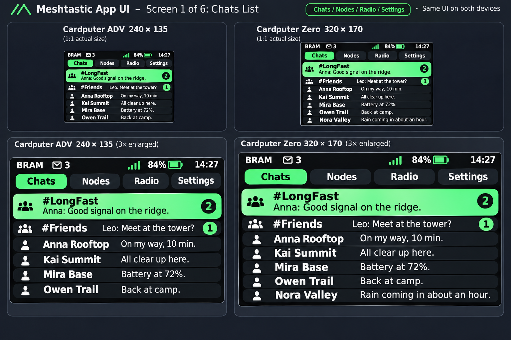
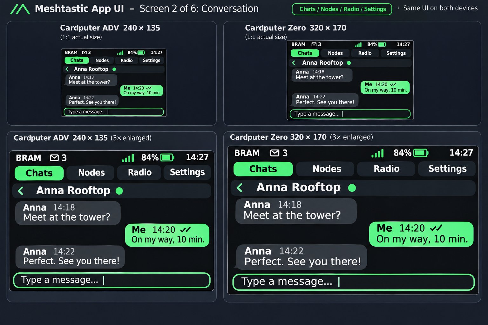
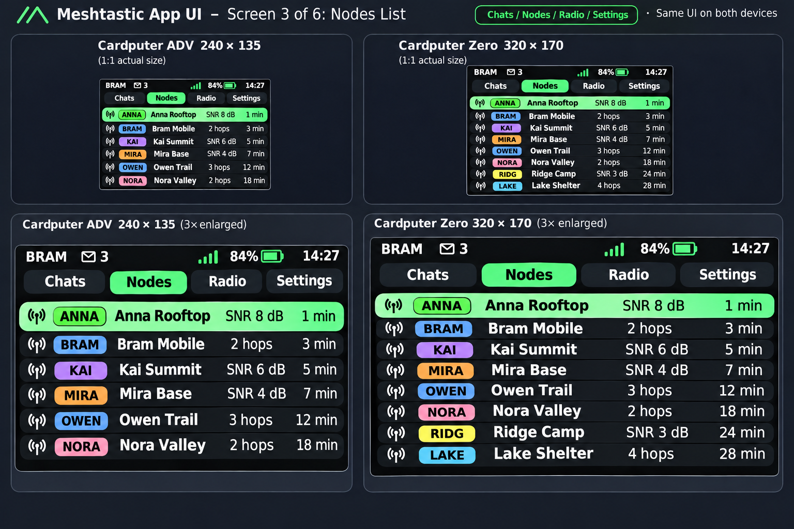
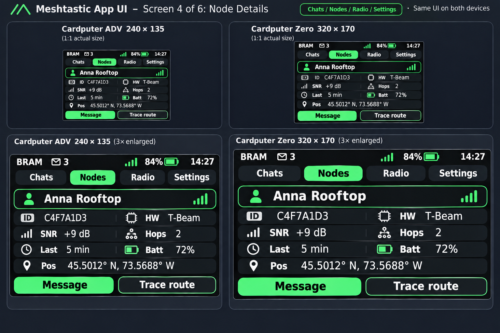
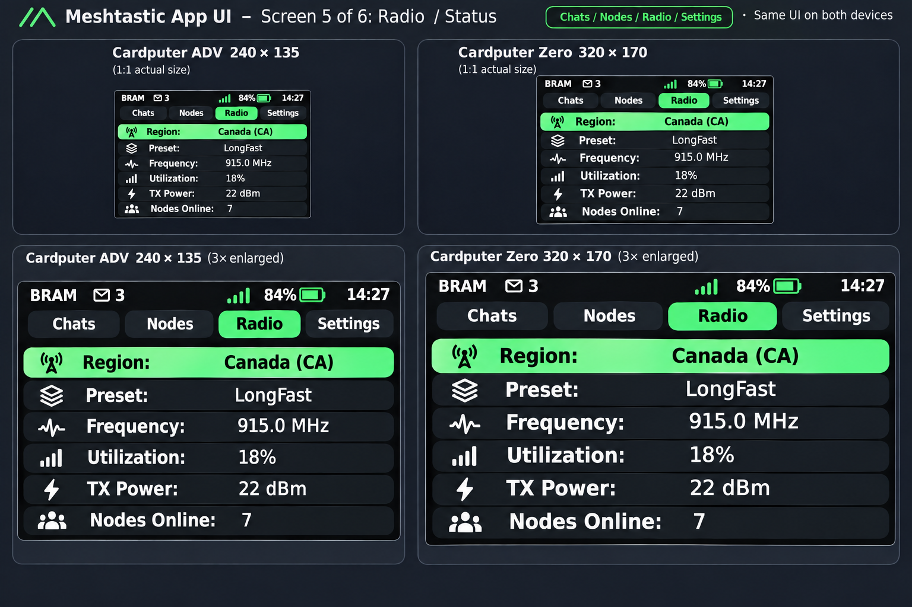
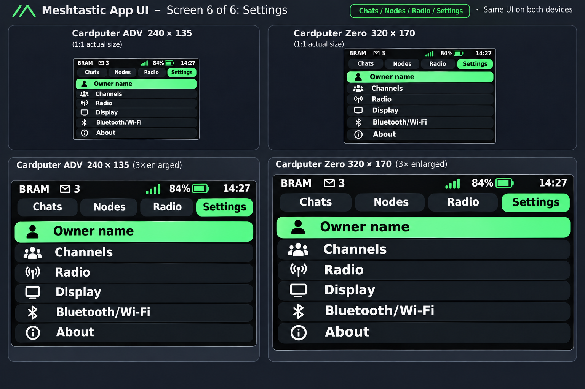

# MeshCard

Meshtastic on the M5Stack Cardputer, with an M5Stack U115 LoRa unit as the radio.

- **meshcard/** – the MeshCard screen app. Based on [s0liton/MeshZero](https://github.com/s0liton/MeshZero) (GPL-3.0), credit kept.
- **meshtastic-firmware/** – Meshtastic firmware with the U115 radio and MeshCard screens for the Cardputer ADV (`m5stack-cardputer-adv-meshcard`).
- **firmware/** – bridge firmware that runs on the U115 (radio over UART).
- **device-ui/** – Meshtastic device-ui copy used by the Cardputer Zero build.
- **zero/** – Cardputer Zero setup files.
- **tools/** – build and test scripts.
- **saved/** – known-good binaries.

License: GPL-3.0 (see `meshcard/LICENSE` and `meshtastic-firmware/LICENSE`).

## Initial mockups

