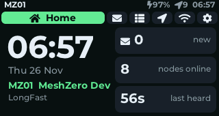
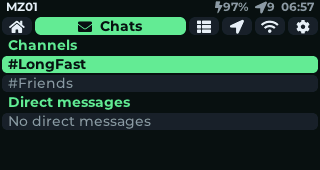
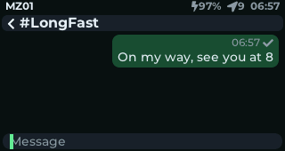
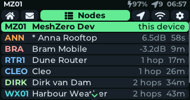
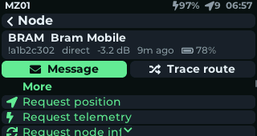
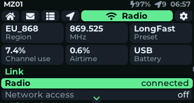
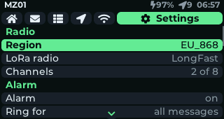
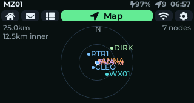
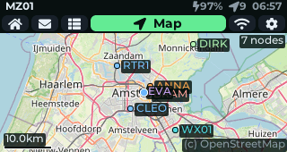
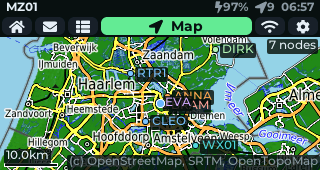

# MeshCard

Meshtastic on the M5Stack Cardputer ADV and Cardputer Zero, using an M5Stack
U115 LoRa unit as the radio. The U115 has no native Meshtastic support;
MeshCard adds a small bridge firmware on the U115 and the changes needed in
Meshtastic and MeshZero to drive it.

## What is in this repository

| Folder | What it is | Origin |
|---|---|---|
| `meshcard/` | Shared ADV and Zero interface, pinned as a Git submodule | [MeshZero fork](https://github.com/DiaLFonZo/MeshZero) based on [upstream MeshZero](https://github.com/s0liton/MeshZero) |
| `meshtastic-firmware/` | Meshtastic firmware with U115 support and the MeshCard screens for the Cardputer ADV (`m5stack-cardputer-adv-meshcard`) | Modified copy of [Meshtastic firmware](https://github.com/meshtastic/firmware) |
| `device-ui/` | Meshtastic UI used by the Cardputer Zero build | Modified copy of [Meshtastic device-ui](https://github.com/meshtastic/device-ui) |
| `firmware/` | Bridge firmware that runs on the U115 (radio over UART) | Original MeshCard work |
| `zero/` | Cardputer Zero setup files | Original MeshCard work |
| `tools/` | Build, flash and test scripts | Original MeshCard work |
| `docs/` | How-to and screenshots | Original MeshCard work |
| `saved/` | Known-good binaries, with their sources listed in [saved/README.md](saved/README.md) | Built from this repository |

Each imported project has a `MESHCARD_CHANGES.md` listing what MeshCard changed.
See the [development workflow](docs/HOWTO.md#shared-ui-development) for submodule updates.

How to build and install: [docs/HOWTO.md](docs/HOWTO.md)

## Credits and Acknowledgments

MeshCard is built on the work of these projects and their authors:

- **[Meshtastic](https://meshtastic.org/)** — the [firmware](https://github.com/meshtastic/firmware) and `meshtasticd`, the [device-ui](https://github.com/meshtastic/device-ui) and the [protobufs](https://github.com/meshtastic/protobufs), by the Meshtastic project and its contributors (GPL-3.0).
- **[MeshZero](https://github.com/s0liton/MeshZero)** by Pedro Santos ([s0liton](https://github.com/s0liton)) — the Meshtastic client for the Cardputer Zero that the MeshCard app is built from (GPL-3.0-only).
- **[LVGL](https://github.com/lvgl/lvgl)** (MIT), **[nanopb](https://github.com/nanopb/nanopb)** by Petteri Aimonen (zlib), **[quirc](https://github.com/dlbeer/quirc)** by Daniel Beer (ISC) — used by MeshZero.
- **[Montserrat](https://github.com/JulietaUla/Montserrat)** and **[Noto Emoji](https://github.com/googlefonts/noto-emoji)** fonts (SIL Open Font License 1.1).
- **[Heltec CubeCell-Arduino](https://github.com/HelTecAutomation/CubeCell-Arduino)** — the core the U115 bridge is built with, including Cypress and Semtech drivers.
- **[pyOCD](https://github.com/pyocd/pyOCD)** and the **[Raspberry Pi debugprobe](https://github.com/raspberrypi/debugprobe)** — used to flash the U115.
- **[Contact](https://github.com/pdxlocations/contact)** by pdxlocations — terminal Meshtastic client, launched on the Zero when installed.

**MeshCard's own work** (by DiaLFonZo): the U115 bridge firmware, the U115
radio support added to Meshtastic, the MeshCard screens and alerts added to
MeshZero, the Cardputer ADV and Zero builds, and the tools and docs in this
repository. It does not claim any of the upstream work above.

**AI assistance:** MeshCard was developed with substantial help from
[Claude](https://www.anthropic.com/claude) (Anthropic), through Claude Code.
Much of the code and documentation was written by Claude under DiaLFonZo's
direction and testing; those commits carry a `Co-Authored-By: Claude` line.
The `docs/codex-*.md` reports were written with OpenAI Codex.

Full list of sources, versions, licenses and notices:
[THIRD_PARTY_NOTICES.md](THIRD_PARTY_NOTICES.md).

Meshtastic® is a registered trademark of Meshtastic LLC. MeshCard is an
independent project, not affiliated with or endorsed by Meshtastic LLC,
the MeshZero author, M5Stack or Heltec Automation.

## License

MeshCard is released under the **GNU General Public License v3.0** — see
[LICENSE](LICENSE). The U115 bridge code in `firmware/u115_bridge/` is under
the MIT license ([its LICENSE](firmware/u115_bridge/LICENSE)). The copied projects keep their own licenses and headers
(`meshcard/LICENSE`, `meshtastic-firmware/LICENSE`, `device-ui/LICENSE`).
Binaries built from this repository are covered by the same license; the
sources of the saved binaries are listed in [saved/README.md](saved/README.md).

## Cardputer Zero screenshots

These are 320 × 170 captures of MeshCard running against a simulated mesh.
Use [the screenshot script](docs/HOWTO.md#5-pc-preview-screenshots-without-a-device)
to regenerate them or capture the ADV layout.

| Home | Chats | Conversation |
| --- | --- | --- |
|  |  |  |

| Nodes | Node details | Radio | Settings |
| --- | --- | --- | --- |
|  |  |  |  |

| Radar | Street map | Topographic map |
| --- | --- | --- |
|  |  |  |

See the [map controls and offline cache](docs/HOWTO.md#maps-on-the-zero) for
details.
